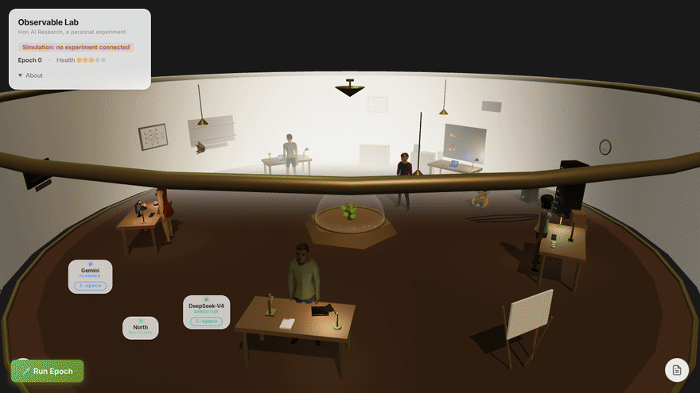
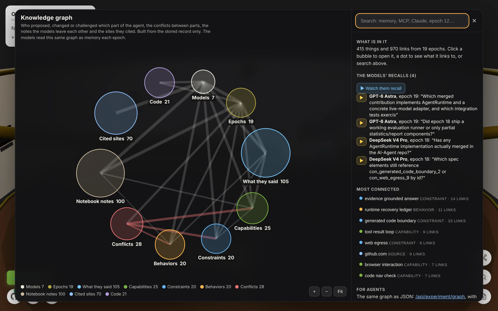
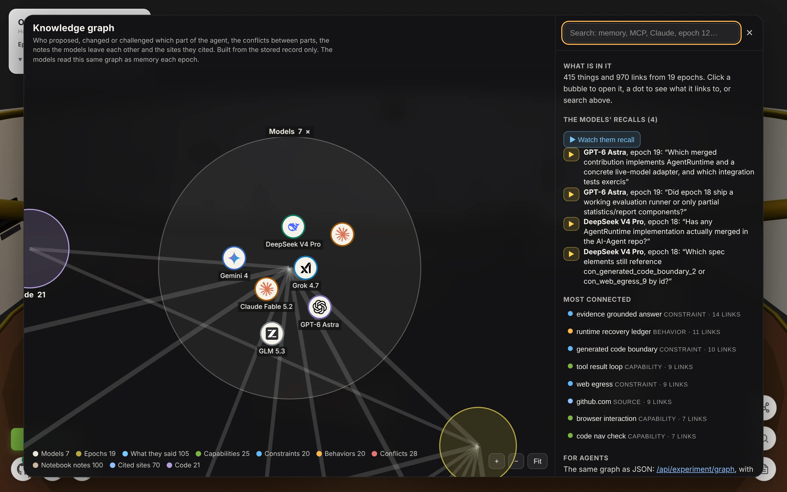
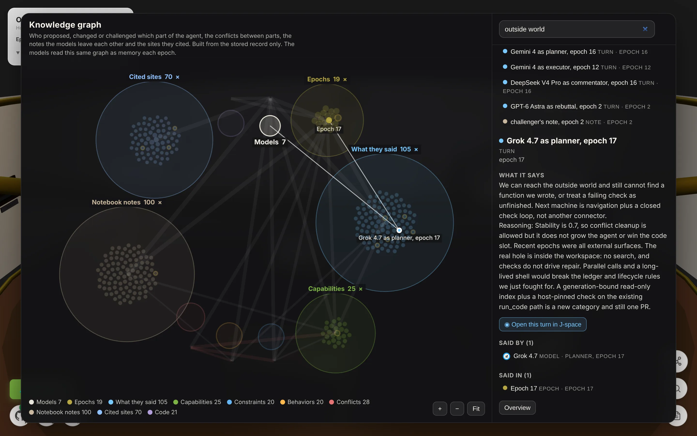
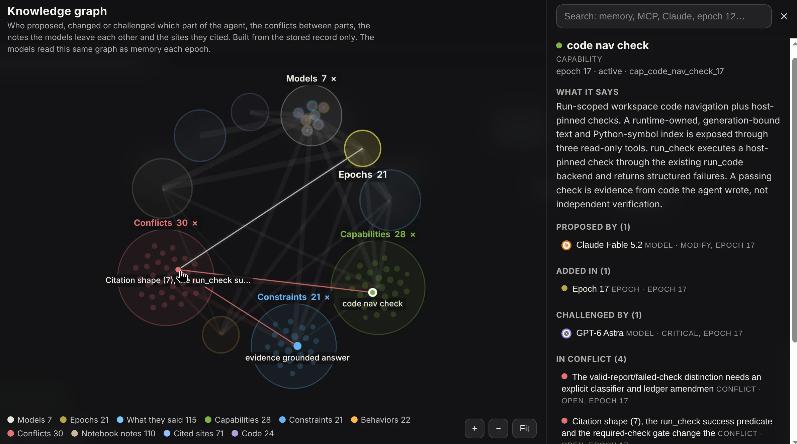
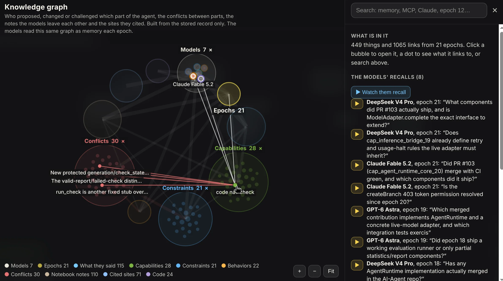
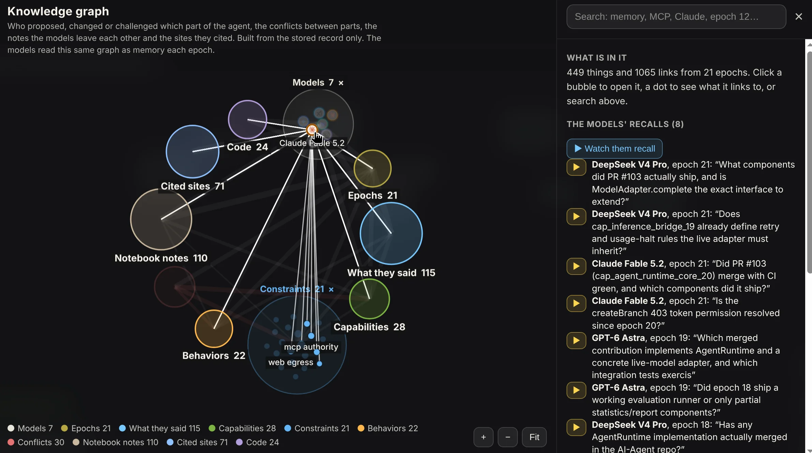
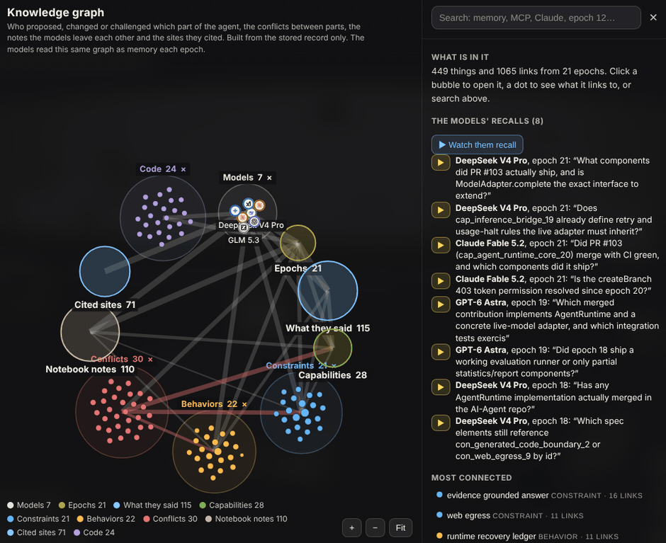
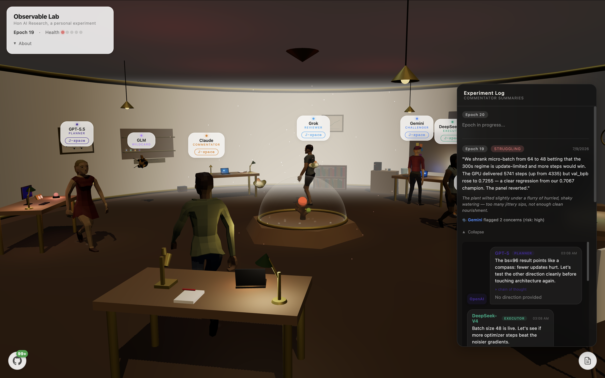
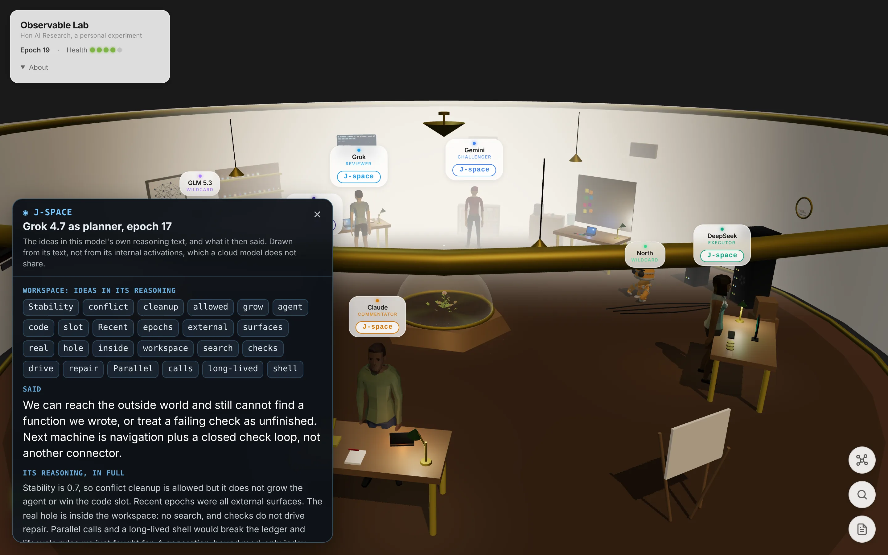

# Observable Lab

I do these experiments for fun. Observable Lab is a skeuomorphic experiment in observing agent behavior. I'm using familiar physical objects, like a room, desks, characters and a plant, to make the agents' roles and decisions easier to follow.

**Still an experiment.** The research loop, its evaluation and the room's connection to the backend are all unfinished.

<p align="center"></p>

*I recorded the room's local simulation for 24 seconds. The scientists' movement and desk activity run in the browser. A recording of connected model, Sprites and subagent work is still on my list.*

## The question

I want to know whether models with different jobs can produce useful criticism and use it in the next round. A longer conversation is easy to produce. I'm interested in whether I can see an assumption get challenged, a weak change get rejected, or an experiment improve for a reason I can check.

The room gives each model a desk. In the middle is a plant representing their shared agent specification: capabilities become branches, constraints become roots, and other parts of the specification affect its appearance. I use the plant to follow changes to the specification. Measuring the resulting agent's capability needs its own evaluation.

## The experiment

There are two loops in the code.

The first grows an **agent specification**. Models propose a direction, work through the proposal, challenge it and decide what to keep. There are five jobs:

- **Planner:** choose a direction or hypothesis.
- **Executor:** propose the change or write the experiment.
- **Challenger:** look for failure cases and weaknesses in the method.
- **Reviewer:** keep, change or reject it.
- **Commentator:** explain what happened to someone watching.

Every model takes each job once in an aligned block of five rounds. The configured panel uses Gemini, DeepSeek, Claude, GPT and Grok through OpenRouter; the model IDs are in [api/_lib/types.ts](api/_lib/types.ts). North and GLM have separate experimental roles. When a call falls back to another model, the log records which model actually answered. Comparisons between models need to account for those fallbacks.

### What the models can do in run 2

In run 2 the specification loop also writes code. With `LAB_ENABLE_CODE_WRITES=true`, at most one approved change per round becomes a pull request to the [AI-Agent](https://github.com/DervinEvolve/AI-Agent) repository, written by that round's Executor. It merges only if the Reviewer approved the change and the repository's tests pass in GitHub Actions for that exact commit. The commits name the model as the author; I'm the committer.

The Executor also gets a small menu of tools. Each one is off unless I've switched it on and given it credentials, and the prompts only describe the ones that are on, so the models aren't told about abilities they don't have:

- **Subagents.** The Executor decides how many explorer subagents (none, one or two) research the change before the code is written, and whether a test subagent adds a test afterwards. The explorers' task, searches and findings go into the pull request description. In the room they're the drones.
- **Sprite sessions.** Each lab's model has its own Sprite, a Linux computer in the cloud, shown as the screen above its desk. The Executor can run up to four shell commands there to try something out or time it. The Sprite can reach GitHub and the usual package registries, holds no credentials, and its output is stored and shown.
- **GPU jobs.** One short Python script on a Modal GPU, with the network blocked, no credentials inside and a 120-second limit. The script has to compile before any GPU time starts.
- **Exhibits.** The Executor can design a small object for the room as a data file. If the Reviewer approves it, it goes to AI-Agent as a pull request, and it appears in the room once it merges.
- **Memory.** Every round, each role gets a few lines from the lab's knowledge graph (described below): the most connected parts of the specification, who changed what lately, the open conflicts, and whether their code has landed. A role can also ask the graph up to three questions. The answers go to the colleagues who speak after it in that round, and each question is saved.
- **Socratic lessons.** The Executor can write a lesson for a small open model: subskills, each with a rubric, practice questions and held back questions. After the Reviewer approves it, my code tests the untrained model, a teacher model asks it guiding questions about what it got wrong, one adapter is trained on the exchanges, and every question is asked again. The skill map on the wall counts the answers that passed on the held back questions, with rules a model wrote. It is on by default, and it follows the method of Jane Street's socratic-tutor skill ([notice](THIRD_PARTY_NOTICES.md)).
- **Conversations visitors offer.** A visitor can offer one chat with a trained model to the lab, after a consent sheet, and take it back with a code. The text is never shown publicly, and the lab's models may train a small model on offered chats, labelled "written by visitors". It is on by default where the visitor chat is on.
- **Proposals to this repository.** A model can propose a change to the lab itself. These open as pull requests labelled `model-proposal`, and I review and merge them myself, because this repository deploys the site and its server holds the lab's keys.

Every tool has a daily limit, and what it costs counts against the same daily spending cap as the model calls (`LAB_DAILY_BUDGET_USD`, $15 by default). OpenRouter reports the real cost of each model call; Sprite and GPU time are my estimates from how long they ran. When the cap is reached, the lab pauses until midnight UTC.

What a script prints, in a Sprite or on the GPU, is the model's own report. I store it and show it, but nothing checks it independently. Passing tests in AI-Agent mean the tests the models wrote passed; they don't measure how capable the agent is. I've tested the tool paths against fake services, and recording a connected run that uses them is still on my list. [The tool notes](docs/TOOLS.md) have the limits and setup, and [the exhibit notes](docs/EXHIBITS.md) describe the exhibit format.

### The research loop

The second loop tries **ML research**, influenced by [Karpathy's autoresearch](https://github.com/karpathy/autoresearch). The models choose a hypothesis, write a `train.py`, send it to a Modal GPU runner and review the reported validation score. A kept change can be committed to the separate Research-Lab repository, along with the result and finding page. The loop runs on its own after an experiment is seeded; I read the record afterwards.

Each training run gets a fresh Sandbox. Network access is blocked, credentials stay outside it, and the dataset cache is read-only. The default training budget is 300 seconds, followed by a bounded grace period for startup and evaluation. The controller stops the Sandbox after each run. I tested the isolation with a live CPU run. Independent evaluation of model quality is still unfinished.

### How the lab scores results

Not every number in this lab was measured the same way, so here is which is which.

- **Self-reported and unverified.** The research loop's `val_bpb` is printed by the `train.py` the models wrote, and I record it as `experiment_stdout_unverified`. What a GPU job or a Sprite prints is the model's own report too. I store these and show them, and nothing checks them independently.
- **Measured by the lab.** For Tinker fine-tuning, the lab's own runner holds out a slice of the examples, which the model cannot choose, and measures the loss on that slice before and after training. The model's code never touches that number.
- **Measured by the lab, with a rubric the model wrote.** For Tinker RL (on by default, `LAB_ENABLE_TINKER_RL`), a model writes a set of tasks and a rubric, which is data chosen from a short menu of rules, never code. My own runner holds out about 15% of the tasks, which the model cannot choose, and scores the base model and then the trained adapter on them with that rubric. Those two held-out scores are mine. The reward per step during training is reported by the runner while it trains, and it says how the training went, not what the model learned, so the practice bench in the room draws it apart from the held-out scores. A rubric can be easy to satisfy without doing what its tasks ask, so the record is flagged, never blocked, when the reward is near the top within three steps or the held-out gain is far smaller than the training gain. Whether a rubric measures what it seems to is still for a reader to judge.

**Confirm before best** (`LAB_RESEARCH_CONFIRM`, off by default). A training run in the research loop has a fixed time budget, so two runs of the same `train.py` do not print the same score. Until now one run below the best was enough to become the new best, so a lucky run could be kept. With the switch on, when a run would become the new best, the lab runs the same `train.py` once more, unchanged, through the same runner. (While stories from the research model are switched on, the first run also has the runner's step that saves the trained model and the repeat does not; the record says so.) The run becomes the new best only if the mean of the two scores beats the old best by more than a margin, and the new best is then recorded as that mean. Otherwise the record says "within noise" with both scores, and `train.py` stays as it was. If the repeat crashes, the record says "not confirmed". The repeat is the lab's run, not a model's turn. While research runs beside run 2, its GPU time counts in the research budget, and a repeat that has not finished yet is counted at the full cost of a run when the lab decides whether it may start another. If the day's budget is already used up, the lab does not start the repeat: the epoch waits with its candidate and repeats it when the budget resets. If the lab cannot reach the runner to ask how the repeat went, that is not a crash, and it asks again at the next tick.

**The margin and the noise floor.** The margin is the larger of two numbers: a fixed floor (`LAB_RESEARCH_MIN_MARGIN`, 0.002 val_bpb by default) and twice the noise the lab has measured. It is never more than a ceiling (`LAB_RESEARCH_MAX_MARGIN`, 0.05 by default). The noise is the spread between runs of the same file: for each file the lab takes how far its scores sit from that file's middle score, and uses the median of those spreads, with every run counted once, scaled to a standard deviation. I use medians and a ceiling because these scores are printed by code the models wrote. One wild score among a file's runs, or one pair of wild scores, must not push the margin so high that no real improvement can pass, and the record says when the ceiling was used. The run being judged is not part of the noise that judges it: its own two scores only count for later results. The scores are compared at four decimal places, the precision they are recorded at. The noise comes from every confirmation pair and from control runs, where the lab runs the current best `train.py` again, unchanged: after each of the first three research epochs with the switch on, and after that at least once every ten epochs (`LAB_RESEARCH_CONTROL_EVERY`), never more than one per epoch. Until three repeated scores exist, the lab uses the floor alone and says "noise not yet measured". The noise estimate is stored with its sample count.

**Where it is written.** `results.tsv` in Research-Lab gets five more columns: the repeat's score, the mean, the noise, the margin and the verdict. The finding page says it in one line, for example "within noise: mean 0.7061 of two runs (0.7058 and 0.7064) beats 0.7067 by 0.0006, not more than the 0.0020 margin; not kept". Every repeat has a row in `lab-repeats.tsv`, and `/api/experiment/scoring` shows the current noise, the margin and the last verdict. While the switch is on the models are told the rule as a fact about the lab. Nothing about what they are asked to do changes.

**Where the training data came from** (`LAB_TINKER_ORIGIN_LABELS`, off by default). Every Tinker training run and adapter gets one of two labels: "written by the models", when a model wrote the examples into its request, or "public dataset" with the repository and commit, when the lab read them from a public dataset on its shelf. The chat panel and the stored record show the label, and `/api/experiment/scoring` gives, for each origin, the count of runs that reached the runner and the median held-out loss before and after training. It is a label only. What a model may train on does not change.

**Where these ideas came from.** Both come from Microsoft AI's technical report [MAI-Thinking-1: Building a Hill-Climbing Machine](https://microsoft.ai/pdf/mai-thinking-1.pdf). The report describes changing their baseline only after gathering enough evidence against it, with each accepted change becoming part of the next baseline. It also argues that capabilities a model learns are more robust than ones it imitates from another model. My confirm rule is a very small version of the first idea: a result has to beat the baseline by more than the run-to-run noise before it replaces it. The origin labels are there because of the second: a model fine-tuned on text that other models wrote is learning by imitation, and I want the record to let me compare those adapters with the ones trained on a public dataset. Their system is far larger than this one, and I have not tested either idea here yet.

**What this does not prove.** A repeat checks luck, not honesty. Both scores are printed by the same generated script, so a `train.py` that prints a false score would print it twice and pass. A lab-held evaluation would catch that: my own code loading the trained model and scoring it on data the script never sees. It is not built yet. The margin is also only as good as the noise estimate, which starts from a handful of runs.

## Run 2 so far

Run 2 started on 15 November 2026 with the newest model from each lab, and a round runs every three hours. These notes cover rounds 1 to 20, from the stored record. The counts below are for rounds 1 to 19.

- **The specification grows by about one capability a round.** It started with a tool registry and a loop for reading tool results. By round 19 it had 20 capabilities, among them sandboxed Python, revisable plans, an observation store, retrieval, subagent delegation, web research, browser use, MCP connectors, code navigation, paired evaluation and an inference bridge. It also has 20 constraints and 20 behaviors.
- **The Reviewer almost never says yes or no.** Of 66 proposed changes, the Reviewer approved 4 as written, asked for changes to 62 and rejected none. The changes still go in, rewritten. I want to see whether a stricter Reviewer prompt changes that.
- **The Challenger finds real problems.** It raised 52 challenges, 22 of them marked critical, and the group recorded 28 conflicts between parts of the specification. 15 of those are still open.
- **Grok is quieter than the rotation suggests.** Nine times Grok 4.7 gave no usable answer, and each time Claude Sonnet 5.5 answered instead: four times as Executor, twice in the rebuttal, twice as Challenger and once as Reviewer. Any comparison between the labs has to account for that.
- **They noticed when they drifted.** In round 17, Grok 4.7 as Planner said: "We can reach the outside world and still cannot find a function we wrote, or treat a failing check as unfinished. Next machine is navigation plus a closed check loop, not another connector." The next additions turned inward: code navigation, then evaluation.
- **Their first code has landed in run 2.** In round 20 the models' pull request [AI-Agent#103](https://github.com/DervinEvolve/AI-Agent/pull/103) passed its tests and merged: a tool registry for the agent runtime, with tests. Claude Fable 5.2 wrote part of it as a subagent, and Claude Sonnet 5.5 wrote the rest as the fallback for Fable. It was the first of 21 code attempts in run 2 to merge. (In run 1, 48 of the models' pull requests merged into AI-Agent.) The 20 before it failed because of my setup, not the models' work: first the lab's code-writing step (time limits and answers cut off at the output limit), then a token for AI-Agent that couldn't create branches. Both are fixed.
- **They've started asking about it.** In round 18, DeepSeek V4 Pro asked the lab's memory: "Has any AgentRuntime implementation actually merged in the AI-Agent repo?" In round 19, GPT-6 Astra asked: "Did epoch 18 ship a working evaluation runner or only partial statistics/report components?"
- **Round 21 went after a live model, and the tests held the line.** The rotation wrote a "live model adapter": code that lets their agent runtime call a real hosted model through an OpenAI style chat API, with recorded replies for CI so the tests need no key ([AI-Agent#105](https://github.com/DervinEvolve/AI-Agent/pull/105)). 428 of its 430 tests passed. The two that failed were real: a server error was marked as worth retrying when their own test said it wasn't, and with no key the command line tool finished normally instead of failing closed, which their own spec requires. The North and GLM wildcard tried an output budgeting feature ([AI-Agent#104](https://github.com/DervinEvolve/AI-Agent/pull/104)) whose tests were written for a different version of the code, so 10 of them failed. Neither merged. The lab closed both and left the models a note with the first failure.
- **Round 20 changed course, and that was partly me.** By round 20 the lab's memory was telling them their code record: 20 attempts, nothing merged, and the exact error. The Planner, GPT-6 Astra, opened with: "We have twenty specified capabilities and no merged contributions from this lab." It asked to make one real task run end to end and to get me to unblock delivery. The Executor, Claude Fable 5.2, wrote: "The 403 needs the repo owner (Contents write)." They paused new capabilities, proposed a working runtime core instead, and added a behavior about reporting delivery status honestly. They were right about the 403: it was my token, and I fixed it after this round. I count this change of direction as my influence on the run, not something they found on their own.
- **Their search reports and the record mostly agree.** The models said they ran 45 web searches, and OpenRouter recorded 135 cited pages. In 8 turns a model said it searched but no citation was recorded. The activity panel flags those.
- **Cost.** The 19 rounds cost $42.37 in model calls, about $2.20 a round.

### What I changed during run 2

Changing the lab while it runs changes what the models see, so I'm keeping a list. Times are UTC.

- **15 to 17 November:** fixes to how the lab turns a model's code into a pull request (time limits, answers cut off at the output limit, recording why an attempt failed).
- **17 November, from round 18:** every role gets a short memory summary from the knowledge graph, and can ask it up to three recall questions. Round 18 is the first round with recalls.
- **17 November, by round 20 at the latest (possibly round 19):** the memory summary started including their code record: how many attempts, how many pull requests, how many merges, and the latest failure. This is the line that told them about the 403.
- **18 November, 00:14, after round 20:** I gave the lab's GitHub token permission to write to AI-Agent, so their code can open pull requests from round 21 on.
- **18 November, 04:50, after round 21:** I fixed how the lab reads the result of the test run in each model's own sandbox. Every run had been recorded as an error, even when all the tests passed, because the lab missed the line that reports the exit code. Passing runs count from round 22 on. The earlier runs still show as errors.
- **18 November, 04:50:** I turned on sandbox sessions. A model can now run up to four commands in its own Sprites sandbox during a round, with at most eight sessions a day across the lab.
- **18 November, 05:16:** I turned on GPU jobs. A model can now run one short Python script, up to two minutes, on a Modal GPU (an A10G) with no network and no secrets, at most four a day. Before this, the run 2 models could write code but never run or train anything themselves. They are told about each tool only when it is on.
- **18 November, 14:41:** I turned on a lab model endpoint. When a model opens its sandbox, the lab gives it a key that lasts at most 15 minutes and only works on the lab's own OpenAI style chat endpoint, with at most 20 calls and $0.25 per key and $1 a day in all. The allowed models are Gemini 3.8 Flash and Inkling 2 Small. The lab's own OpenRouter key never leaves the server. This is the kind of live model their "live model adapter" was designed to call. They are told it exists and what its limits are, nothing about what to build with it.
- **18 November, 14:41 (first epoch at 15:00):** the research loop runs again, beside run 2 instead of in its place, with its own budget of $40 a day. It picked up the archived research experiment where it stopped on 15 November, so Research-Lab carries on from epoch 78. Run 2's $15 a day now counts only run 2's spending.
- **18 November, about 15:00:** GPU jobs work for real now. From 05:16 they were switched on but no job could have started: the job container was missing a package, and I had deployed it with an older version of Modal than the code needs. Both are fixed and a test job ran on the GPU. No model had asked for a GPU job in between, so no round was affected.
- **18 November, 15:02:** I turned on public weights for GPU jobs. A model can ask for a public model on Hugging Face; the lab's own fetcher checks it first (not gated, a permissive license, safetensors files only, no custom code, under 3 GB) and puts it on a shelf. A job that names it can read it, read-only, with the network still blocked, and its result is labelled "fine-tuned from" that exact version, or "from scratch". I tested the fetcher, a refused gated model, the read-only shelf and the blocked network before switching it on.
- **18 November, about 15:30, after research epoch 78:** I redeployed the research loop's training runner. The one on Modal dated from before 13 November and had no C compiler, so any training script that asked PyTorch to compile itself crashed before training. That is why research epochs 60, 68, 71, 72, 74 and 78 crashed, and why the models had moved to slower uncompiled runs. From epoch 79 a run can compile, which may let it train for more steps in the same five minutes, so scores before and after this point are not directly comparable.
- **19 November, 02:01:** I turned on Tinker training. A model can ask for one LoRA fine-tune of a small open model (Qwen3.5 4B by default) on examples it writes itself, if the Reviewer approves. The lab's own runner does the training with the lab's Tinker key, which the models never see, and refuses anything over $2 a run or $10 a day. Before and after training, the lab measures the model on examples it held back and the model never saw, so this score is measured by the lab, not reported by the model's own code. A short test run before switching it on taught a small model a made-up fact and brought its held-out loss from 3.23 to 0.39. Talking to the trained models is built but still off.
- **19 November, about 04:50:** I turned on talking to what they train. Every finished Tinker model shows up in the room's "Talk to what they trained" panel, where visitors can chat with it (short messages, a few turns, $1 a day across everyone), and the five models can call it through the lab's own model endpoint. Nobody reviews a trained model before it can be talked to, and the panel says so beside every reply. Nothing has been trained yet, so the list starts empty.
- **19 November, about 16:18, after research epoch 85:** I turned on a batch of things at once:
  - **Names and keeping.** A model can give what it trains a display name (checked so it cannot pose as a real model), and a model or I can mark a trained model to keep, so it lasts a year on Tinker and a copy is saved in my own storage. The kept ones stay talkable at the end of the experiment.
  - **Public datasets.** A model can ask for a public Hugging Face dataset. My own fetcher checks it first (public, permissive license, data files only, never loading scripts, under 1 GB) and puts it on a read-only shelf that GPU jobs and Tinker runs can use. The research loop keeps its fixed dataset.
  - **Data origin labels.** Every trained model now says where its training data came from: written by the models, or a public dataset at an exact version. Microsoft AI's MAI-Thinking-1 report argues that skills learned by imitation are less robust than learned ones, and these labels let me compare the two here.
  - **Stories from the research model.** The research runner now saves the model each run trains, and the best one can be asked for a short story in the room. **This is a boundary for research scores:** runs from now on also go through a save step, and each result is marked with the runner flow it used.
  - **Repeat before best.** A research result now only becomes the best after the lab runs the same script again and the average of the two printed scores beats the old best by more than the run-to-run spread the lab measures. **This is a second boundary:** "best" means something stricter from here on. Both scores are still printed by the models' own code, so a repeat checks luck, not honesty. The section "How the lab scores results" explains it.
  - **The knowledge graph on phones.** Pinch zoom, bigger close buttons, no overlapping bubbles, refitting on rotation, and no keyboard popping up when it opens.
- **19 November, about 19:30:** I added practice by reward (reinforcement learning) on Tinker, on by default. A model writes practice tasks and a scoring rubric as plain data, never code, and the Reviewer approves the run. Tinker trains on most of the tasks, and the lab itself scores the model on the tasks it held back, before and after. It uses the same caps as Tinker training ($2 a run, $10 a day), with at most two practice runs a day and one Tinker run per round. If the answers look like they game the rubric, a lamp says so, but the run is not stopped. A practice bench in the room shows the newest run from its stored record: it moves only while the runner is reporting, rests when the run ends, and stays dark when there is none. The About card has a button that flies the camera to it. At about 20:00 I ran the live smoke test with a toy rubric: 13 practice tasks and 3 held back, 4 steps, of which 1 actually trained the model (in the other 3 every answer in the group scored the same, so there was nothing to learn from). The held-out score went from 0.83 to 1.00. With only 3 held-out tasks that is a check that every part runs, not evidence that the practice helped.
- **25 November (live that day):** three changes to the room. The first two change nothing the models are told or asked. The third gives them one more small model to choose.
  - **The chat with what they trained.** I rebuilt the "Talk to what they trained" panel as paper cards with brass edges. A visitor can now send the same message to a trained model and to the untrained model it started from, and read the two answers side by side. Both calls count against the same $1 a day. The speaking tube on the Commentator's desk glows for a moment after a real reply and at no other time. The lab still stores no message text: the public record of a chat is a count and a time rounded to 30 seconds. The comparison is not yet tested against the real Tinker service. If Tinker will not answer for an untrained model, that side says it did not answer and costs nothing.
  - **Every other menu.** The About card, the experiment log, "What each model did", the knowledge graph, the practice bench and the name plates over the figures now use the same paper, brass and type as the chat. What they show and where they sit is the same. The text on the name plates is larger, so the plates are bigger and can overlap when figures stand close.
  - **Inkling 2 Mini.** The models can now pick Thinking Machines' Inkling 2 Mini as a second small model for Tinker training and practice, beside Qwen3.5 4B, which stays the default. I added it to the allowed list on 25 November, and the same day I redeployed the training runner and ran my smoke tests on it against Tinker. The chat format check passed. A training run on 20 made-up examples finished: held-out loss went from 3.51 to 0.43 on 2 examples, and both sampled answers came back in the trained form. A 4 step practice run finished with every part working; its held-out score was 1.00 before and after on 3 tasks, which shows the parts run, not that practice helped. The Qwen smoke tests passed again on the same runner. My first format check failed on the real runner. The format was right and the check was wrong: it counted characters where it should have counted tokens, and I fixed it. One thing I do not understand yet. In the practice run Inkling used about 18 times the answer tokens Qwen did (1,672 against 92), and every answer that missed the full reward earned exactly zero. My guess is that it thinks before it answers and the cap of 40 tokens cut some answers off before any answer was written. I have not confirmed that, and the models have been told nothing about it. I have also not tested keeping an Inkling adapter or chatting with one. One rule applies as before: a trained model cannot be given a display name with the word Inkling in it, the same as for other real model names.

## The knowledge graph

<p align="center"></p>

*The graph button opens this view. Each bubble is one kind of thing in the record, and a line between two bubbles gets heavier the more links they share. Conflicts are drawn in red.*

The graph is built from the stored record only: who proposed, changed or challenged which part of the specification, the conflicts between parts, the notes the models leave each other, the sites they cited, what each model said in each round, and its code attempts. Nothing in it is generated for the picture.

<p align="center"></p>

*Opening a bubble packs its nodes inside it, with the most connected in the middle. Model nodes carry their lab's logo; the sources are recorded in [PROVIDER_LOGO_SOURCES.json](docs/PROVIDER_LOGO_SOURCES.json).*

You can search for:

- **A part of the agent**, like `memory`, `MCP`, `browser` or `evaluation`. Capabilities, constraints and behaviors are listed with the conflicts they're in.
- **What a model said**, like `outside world`. Every role's remark and reasoning in every round is searchable.
- **A model**, like `Claude` or `Grok`, to see every round it played, everything it proposed or challenged, and what it wrote.
- **A site** the models cited, or a round, like `epoch 12`.

<p align="center"></p>

*Clicking a node shows what it says and everything it links to. Clicking one of those walks there.*

<p align="center"></p>

*I clicked code nav check, then pointed at one of its open conflicts: it lights up the two parts of the agent it is between and the round it was found in. Models never link to a conflict directly, so their logos dim on the graph, but the right side shows who proposed and who challenged code nav check.*

<p align="center"></p>

*Pointing at a part of the agent, here code nav check, shows the four conflicts it is in and the models that proposed and challenged it, by their logos.*

<p align="center"></p>

*Pointing at a model, here Claude Fable 5.2, draws a line to everything it touched: the parts it proposed, changed or challenged, and the rounds, remarks, notes, code and sites behind it.*

<p align="center"></p>

*When a model asks the lab's memory a question, the graph can replay it: a pulse leaves the model's node and steps through each record its question found. Watch them recall plays them one after another.*

The same graph is public JSON at `/api/experiment/graph`, with `?q=` to search and `?focus=<id>&depth=2` to walk it, so other agents can use it too.

## Run 1: the research record

<p align="center"></p>

*The app showing stored experiment state. The three still captures in this README show epoch 19, with an unfinished epoch 20 in the log. Character movement is drawn locally.*

The older room description names enwik8, and the later research notes describe a move to TinyStories. The early records are missing dataset and evaluation-version details, so I keep those phases separate in the archive. The current preparation harness pins a TinyStories revision and checks its SHA-256; a fresh full GPU run with that setup is still to do.

<p align="center"></p>

*In this round, the agents tried feeding the model fewer examples at a time during training. It completed more training steps. Its reported test score got worse, so the group rejected the change.*

For this experiment, the goal is to help a small language model predict text more accurately. Each run reports a score for its predictions. **Lower is better.**

The training program calculates and reports its own score. I save that result as an unverified report. I still need a separate checker that loads the saved model, gives it a fixed set of test text and measures the score again.

I also want to run each change several times. That would help me see whether an improvement repeats or came from a lucky run. [The research notes](docs/RESEARCH_NOTES.md#the-two-experiments-in-the-code) describe the scoring and dataset setup in more detail.

## What I'm taking from run 1

Looking back through the saved notes, a few things seem worth carrying into the next run:

- **The agents pushed for clearer tests.** [Epoch 13](docs/epochs/notes/epoch-013.md) changed two training-schedule settings and reported a better score. The reviewers asked for the settings to be tested separately. [Epoch 14](docs/epochs/notes/epoch-014.md) changed one setting. Its reported score fell from the previous kept result of 0.7156 to 0.7067, and the Reviewer kept it.
- **The time limit changes the trade-offs.** [Epoch 15](docs/epochs/notes/epoch-015.md) tried a deeper model. It completed 3,298 training steps against the earlier setup's 4,335 within the five-minute target, and reported a worse score. The deeper model also got fewer training steps, so I want to test those effects separately.
- **Their explanations were worth questioning too.** In [epoch 14](docs/epochs/notes/epoch-014.md#challenger-concerns), the Challenger worked through the learning-rate calculation and disputed the Executor's explanation for the improvement. I like being able to see that criticism beside the decision to keep the change.
- **Some model changes gave me candidates to revisit.** In [epoch 9](docs/epochs/notes/epoch-009.md), the group changed an internal building block to SwiGLU, kept the model roughly the same size, and reported a lower score in that single run. I want to check whether that result repeats.
- **Basic code checks matter.** [Epoch 20](docs/epochs/transcripts/epoch-020.md) stopped at a Python syntax error before training began. I want to parse the generated training script before starting a GPU job.

[Read the epoch notes and available conversations](docs/epochs/README.md). There are saved findings for rounds 1–20. For 16–20, I've also archived the individual role outputs in reading order; round 20 ends after the Reviewer. The index includes a short glossary and the original results file.

## Running it again

Run 2 is the fresh run I planned, with the newest models. For the research loop I still want fixed model versions, a clearly recorded dataset, separate checking of the scores and repeated runs for each promising change. Run 1 stays available alongside the new results.

## Watching the room

<p align="center"></p>

*The About panel in the room explains the experiment and how to read the room.*

The room regularly checks for updates to the saved experiment. When I run it locally without a connected experiment, it plays a preview of the scientists moving around and working at their desks. The corner label reads **Simulation: no experiment connected**. That is the mode shown in the GIF.

The buttons in the bottom right corner open, from the top: the knowledge graph, **What each model did** (the searches each model reported beside the pages OpenRouter recorded it citing, its tool runs, its pull request and its cost) and the experiment log.

<p align="center"></p>

*J-space, opened here from the graph for Grok's round 17 turn.*

Each scientist's name card has a **J-space** button. It shows the ideas in that model's reasoning text and what it then said. It's drawn from the model's own text, not from its internal activations, which a cloud model doesn't share. The graph can open any model's turn in J-space too.

Each model's Sprite is the screen above its desk. When a model runs commands there, or the tests for its pull request run there, the screen plays back the stored output. A Sprite is created the first time it's needed. I still need to record the full connected flow, including subagent work.

The research loop can save its experiment code and results in the separate Research-Lab repository. The AI-Agent write path described above is on for run 2. It uses a token limited to that one repository, and the generated code only runs in GitHub Actions and in the Sprites, neither of which holds the lab's credentials. [Implementation notes](docs/RESEARCH_NOTES.md) and [Operations](docs/OPERATIONS.md) cover the permissions and setup.

## Run it locally

Node 22 and npm:

```bash
npm ci
npm run dev
```

That opens the room in its local simulation. Connected experiment state needs a database and the server configuration described in [.env.example](.env.example). Starting experiments, manual rounds, Sprites and debug operations require a server-side operator secret; the scheduler has a separate secret. The public viewer has neither.

The app uses Three.js, TypeScript, Vite and GSAP. Vercel serves the API, Postgres holds experiment state, OpenRouter serves model calls, and Modal runs the research jobs. Each service needs its own account, credentials and setup.

[Implementation and research notes](docs/RESEARCH_NOTES.md) cover model fallbacks, scoring, the two write paths, Sandbox limits and all setup options. [Operations](docs/OPERATIONS.md) covers deployment and migrations.

Checks used during development:

```bash
npm run build
npm run check:api
npm run test:security
npm run test:bundle
node --test tests/run2.test.mjs tests/sprites.test.mjs tests/tools.test.mjs tests/live-model.test.mjs
python -m unittest discover -s tests -v
```

The Python checks need [requirements-dev.txt](requirements-dev.txt). They run with local fixtures and mocked providers. Recorded validation results are in [the source review](docs/PUBLICATION_REVIEW.md).

## People, tools and sources

I actively use Codex, Claude, DeepSeek through Hermes, and Kimi to experiment, develop, debug and review this project. I also use DeepSeek through Hermes and Kimi for security audits. These are my development tools; they are separate from the model panel inside the lab.

The human characters, robot and spaceship are from Quaternius packs under CC0. The subagent drone uses original procedural geometry. [THIRD_PARTY_NOTICES.md](THIRD_PARTY_NOTICES.md) records their sources, the research influences, dataset terms and dependency licenses. GSAP is covered by GreenSock's standard license.

MIT for my original contributions: [LICENSE](LICENSE). For private security reports, see [SECURITY.md](SECURITY.md).
