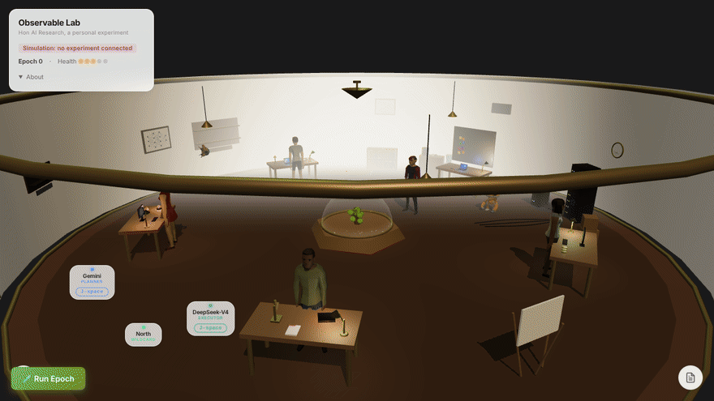
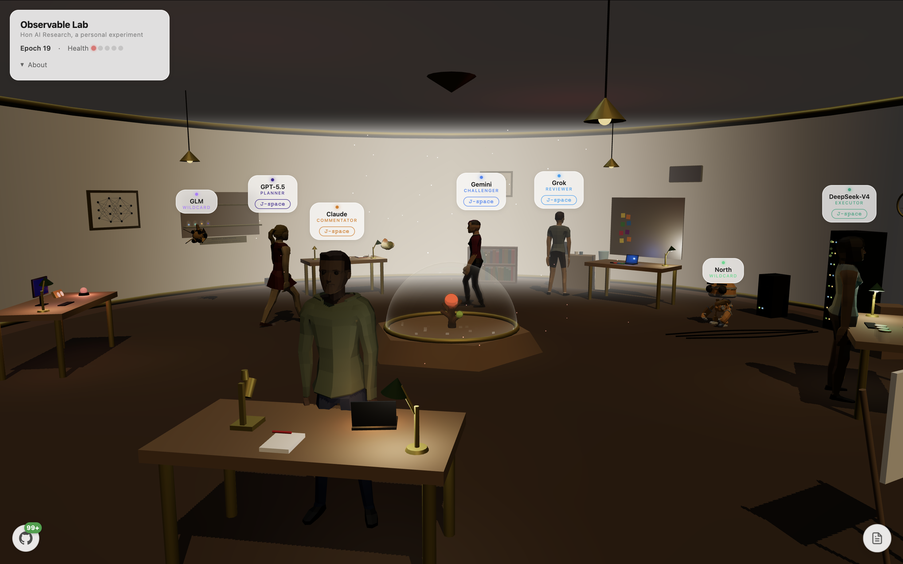
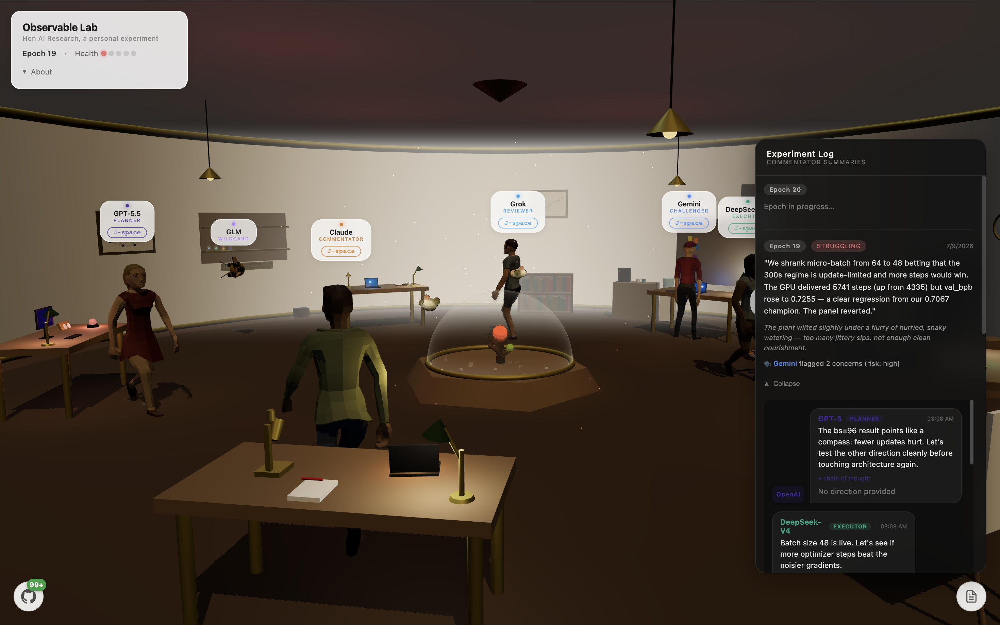
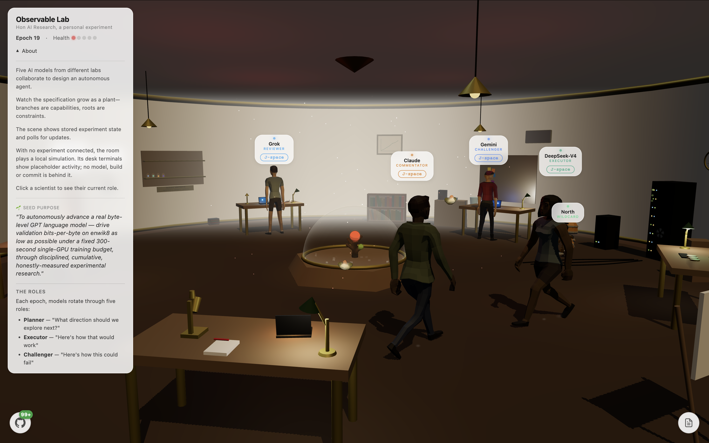

# Observable Lab

I do these experiments for fun. Observable Lab is a skeuomorphic experiment in observing agent behavior. I'm using familiar physical objects, like a room, desks, characters and a plant, to make the agents' roles and decisions easier to follow.

**Still an experiment.** The research loop, its evaluation and the room's connection to the backend are all unfinished.

<p align="center"></p>

*I recorded the room's local simulation for 24 seconds. The scientists' movement and desk activity run in the browser. A recording of connected model, Sprites and subagent work is still on my list.*

## The question

I want to know whether models with different jobs can produce useful criticism and use it in the next round. A longer conversation is easy to produce. I'm interested in whether I can see an assumption get challenged, a weak change get rejected, or an experiment improve for a reason I can check.

The room gives each model a desk. In the middle is a plant representing their shared agent specification: capabilities become branches, constraints become roots, and other parts of the specification affect its appearance. I use the plant to follow changes to the specification. Measuring the resulting agent's capability needs its own evaluation.

## The experiment

There are two loops in the code.

The first grows an **agent specification**. Models propose a direction, work through the proposal, challenge it and decide what to keep. There are five jobs:

- **Planner:** choose a direction or hypothesis.
- **Executor:** propose the change or write the experiment.
- **Challenger:** look for failure cases and weaknesses in the method.
- **Reviewer:** keep, change or reject it.
- **Commentator:** explain what happened to someone watching.

Every model takes each job once in an aligned block of five rounds. The configured panel uses Gemini, DeepSeek, Claude, GPT and Grok through OpenRouter; the model IDs are in [api/_lib/types.ts](api/_lib/types.ts). North and GLM have separate experimental roles. When a call falls back to another model, the log records which model actually answered. Comparisons between models need to account for those fallbacks.

The second loop tries **ML research**, influenced by [Karpathy's autoresearch](https://github.com/karpathy/autoresearch). The models choose a hypothesis, write a `train.py`, send it to a Modal GPU runner and review the reported validation score. A kept change can be committed to the separate Research-Lab repository, along with the result and finding page. The loop runs on its own after an experiment is seeded; I read the record afterwards.

Each training run gets a fresh Sandbox. Network access is blocked, credentials stay outside it, and the dataset cache is read-only. The default training budget is 300 seconds, followed by a bounded grace period for startup and evaluation. The controller stops the Sandbox after each run. I tested the isolation with a live CPU run. Independent evaluation of model quality is still unfinished.

## The record so far

<p align="center"></p>

*The app showing stored experiment state. The three still captures in this README show epoch 19, with an unfinished epoch 20 in the log. Character movement is drawn locally.*

The older room description names enwik8, and the later research notes describe a move to TinyStories. The early records are missing dataset and evaluation-version details, so I keep those phases separate in the archive. The current preparation harness pins a TinyStories revision and checks its SHA-256; a fresh full GPU run with that setup is still to do.

<p align="center"></p>

*In this round, the agents tried feeding the model fewer examples at a time during training. It completed more training steps. Its reported test score got worse, so the group rejected the change.*

For this experiment, the goal is to help a small language model predict text more accurately. Each run reports a score for its predictions. **Lower is better.**

The training program calculates and reports its own score. I save that result as an unverified report. I still need a separate checker that loads the saved model, gives it a fixed set of test text and measures the score again.

I also want to run each change several times. That would help me see whether an improvement repeats or came from a lucky run. [The research notes](docs/RESEARCH_NOTES.md#the-two-experiments-in-the-code) describe the scoring and dataset setup in more detail.

## What I'm taking from the early rounds

Looking back through the saved notes, a few things seem worth carrying into the next run:

- **The agents pushed for clearer tests.** [Epoch 13](docs/epochs/notes/epoch-013.md) changed two training-schedule settings and reported a better score. The reviewers asked for the settings to be tested separately. [Epoch 14](docs/epochs/notes/epoch-014.md) changed one setting. Its reported score fell from the previous kept result of 0.7156 to 0.7067, and the Reviewer kept it.
- **The time limit changes the trade-offs.** [Epoch 15](docs/epochs/notes/epoch-015.md) tried a deeper model. It completed 3,298 training steps against the earlier setup's 4,335 within the five-minute target, and reported a worse score. The deeper model also got fewer training steps, so I want to test those effects separately.
- **Their explanations were worth questioning too.** In [epoch 14](docs/epochs/notes/epoch-014.md#challenger-concerns), the Challenger worked through the learning-rate calculation and disputed the Executor's explanation for the improvement. I like being able to see that criticism beside the decision to keep the change.
- **Some model changes gave me candidates to revisit.** In [epoch 9](docs/epochs/notes/epoch-009.md), the group changed an internal building block to SwiGLU, kept the model roughly the same size, and reported a lower score in that single run. I want to check whether that result repeats.
- **Basic code checks matter.** [Epoch 20](docs/epochs/transcripts/epoch-020.md) stopped at a Python syntax error before training began. I want to parse the generated training script before starting a GPU job.

[Read the epoch notes and available conversations](docs/epochs/README.md). There are saved findings for rounds 1–20. For 16–20, I've also archived the individual role outputs in reading order; round 20 ends after the Reviewer. The index includes a short glossary and the original results file.

## Running it again

I'm planning a fresh run soon with updated models. For that run, I want fixed model versions, a clearly recorded dataset, separate checking of the scores and repeated runs for each promising change. I'll keep this early run available alongside the new results.

## Watching the room

<p align="center"></p>

*Hon AI Research is my project name. The About panel explains how to read the room.*

The room regularly checks for updates to the saved experiment. When I run it locally without a connected experiment, it plays a preview of the scientists moving around and working at their desks. The corner label reads **Simulation: no experiment connected**. That is the mode shown in the GIF.

I'm also working on giving each agent a separate work computer through Sprites. There is code for sending a command to one of those computers and showing its output on the agent's desk. I still need to test and record the full connected flow, including subagent work. Setting up those computers is currently manual, and the desk's success and failure colours need fixing.

The research loop can save its experiment code and results in the separate Research-Lab repository. A broader feature for changing code in AI-Agent is off. That feature can open pull requests and merge them after automated checks. Before enabling it, I need to review its repository access and make sure the checks can run generated code safely, with credentials kept outside the test environment. [Implementation notes](docs/RESEARCH_NOTES.md) cover the permissions and setup.

## Run it locally

Node 22 and npm:

```bash
npm ci
npm run dev
```

That opens the room in its local simulation. Connected experiment state needs a database and the server configuration described in [.env.example](.env.example). Starting experiments, manual rounds, Sprites and debug operations require a server-side operator secret; the scheduler has a separate secret. The public viewer has neither.

The app uses Three.js, TypeScript, Vite and GSAP. Vercel serves the API, Postgres holds experiment state, OpenRouter serves model calls, and Modal runs the research jobs. Each service needs its own account, credentials and setup.

[Implementation and research notes](docs/RESEARCH_NOTES.md) cover model fallbacks, scoring, the two write paths, Sandbox limits and all setup options. [Operations](docs/OPERATIONS.md) covers deployment and migrations.

Checks used during development:

```bash
npm run build
npm run check:api
npm run test:security
npm run test:bundle
python -m unittest discover -s tests -v
```

The Python checks need [requirements-dev.txt](requirements-dev.txt). They run with local fixtures and mocked providers. Recorded validation results are in [the source review](docs/PUBLICATION_REVIEW.md).

## People, tools and sources

I actively use Codex, Claude, DeepSeek through Hermes, and Kimi to experiment, develop, debug and review this project. I also use DeepSeek through Hermes and Kimi for security audits. These are my development tools; they are separate from the model panel inside the lab.

The human characters, robot and spaceship are from Quaternius packs under CC0. The subagent drone uses original procedural geometry. [THIRD_PARTY_NOTICES.md](THIRD_PARTY_NOTICES.md) records their sources, the research influences, dataset terms and dependency licenses. GSAP is covered by GreenSock's standard license.

MIT for my original contributions: [LICENSE](LICENSE). For private security reports, see [SECURITY.md](SECURITY.md).
