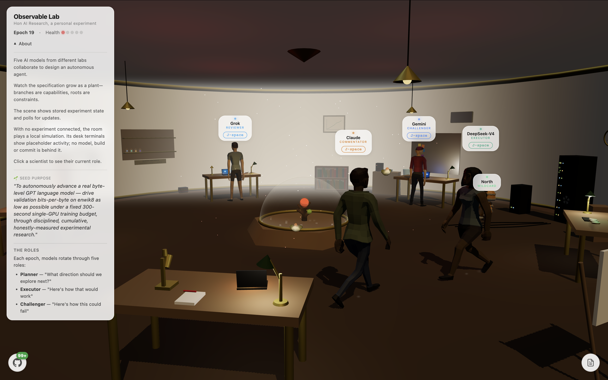
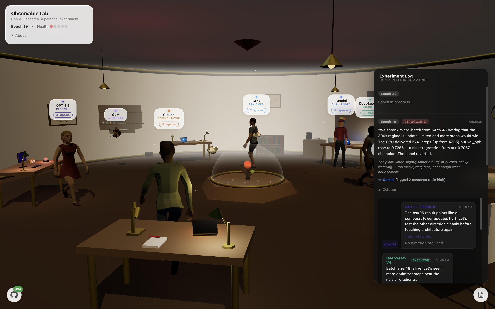

# Observable Lab: implementation and research notes

These are the detailed notes behind the [project README](../README.md). The experiment is unfinished. Stored output, local animation and independently measured results are different things.


The research runs on its own once an experiment is seeded. A scheduler starts each round (an epoch), and the models plan, write, criticise and decide without me approving each step. In the ML loop that includes running generated training code on a GPU and committing kept changes to a research repository. I read the record afterwards.

I do these experiments for fun. This is still an experiment. The interface, the research loop, and the setup are all changing.

## What I'm trying to understand

I want to know whether giving models different jobs produces useful criticism, or just a longer conversation. Does a challenger catch a weak assumption? Does the next round use what the last round learned? Can I tell the difference between a measured result and a convincing explanation?

## What it does today

| Part | What I want it to do | Where it is today |
|---|---|---|
| Role rotation | Every model plays every role, so I can compare them in the same job. | Works on a fixed schedule. When a model call fails, a fallback model answers, and the log names that model and marks the turn as a fallback. |
| Agent specification loop | Models grow and criticise a shared specification for an agent. | Runs. The plant draws the specification; its size and health score say nothing about how capable the agent is. |
| ML research loop | Measured, repeatable improvements to a small language model. | It has run end to end on Modal with an older enwik8 setup. The current pinned TinyStories runner has passed a CPU check only. The score is printed by the generated training code itself, with no independent evaluation and no repeated runs yet. |
| Code contributions | Models ship code to a separate repository through CI. | Off by default. |
| The room | The scene follows what the backend is doing. | Partly. With no backend connected, the room plays a local simulation, and the info panel shows a "Simulation" marker. |

### Stored runs and simulated activity

The stored epochs are the record. Anything else in the room is a picture of the record or a simulation.

| What you see | Where it comes from |
|---|---|
| Experiment log, role outputs, scores, the plant's shape | Epoch rows stored in Postgres, read through the Vercel API |
| The three still images in this README | The current app displaying stored experiment state from epoch 19, with an unfinished epoch 20 in the log. The GIF is different: the local simulation, recorded with `npm run dev` and no backend |
| Scientists taking turns at their desks, and a terminal printing a "simulation: no experiment connected" placeholder about every 12 seconds | A browser-side simulation (`startLocalActivityCycle` in `src/main.ts`). It runs whenever no experiment is connected, and the info panel shows "Simulation: no experiment connected" meanwhile. No model, build or commit is behind it. |
| Movement and effects while an experiment is connected | Local animation in the browser, sometimes cued by the stored epoch |
| `window.lab` in the browser console | A debug helper in development builds only (`npm run dev`). It can play simulated activity on demand. Production builds leave it out. |

## How it works

### The five jobs

| Role | Job |
|---|---|
| **Planner** | Chooses a direction or hypothesis. In the specification loop the Planner and the Executor can search the web. |
| **Executor** | Proposes the change or writes the experiment. |
| **Challenger** | Looks for failure cases and problems with the method. |
| **Reviewer** | Decides what to keep, change, or reject. |
| **Commentator** | Explains the round to someone watching. |

Roles change every epoch. The schedule in [api/_lib/role-rotation.ts](../api/_lib/role-rotation.ts) works in blocks of five epochs (0–4, 5–9, and so on), and inside each block every model takes every role once.

The configured panel uses Gemini, DeepSeek, Claude, GPT, and Grok through OpenRouter. Model IDs live in [api/_lib/types.ts](../api/_lib/types.ts). North and GLM also have separate experimental roles outside that rotation.

Provider availability and fallbacks can change what actually runs. If a panel model gives no usable answer after three tries, the server sends the same prompt to `anthropic/claude-opus-4.8`, then `google/gemini-3.5-flash`, skipping whichever one just failed ([api/_lib/openrouter.ts](../api/_lib/openrouter.ts)). Each stored output records the model that answered in `served_by`. The experiment log and the room's status line then show the fallback model with a "fallback for <assigned model>" note, and commits from the contribution and research loops name the fallback model in their `Model:` trailers. Those commits are authored and committed as my GitHub noreply identity (`api/_lib/commit-identity.ts`); the model that wrote a change appears only in the trailers, never as the git author. Merge commits use whatever identity the GitHub token belongs to. A round with a fallback is not a clean comparison between panel models.

<p align="center"></p>
<p align="center"><sub>The About panel in the current app. Hon AI Research is my project name. This stored run describes enwik8; the current preparation code uses TinyStories.</sub></p>

### The two experiments in the code

The original loop grows an **agent specification**: its purpose, capabilities, constraints, and behaviors. Models propose changes and review each other. The plant is a visual summary of that specification. More branches or a higher health score are not evidence that the agent became more capable.

I've also added an **ML research loop**, influenced by [Andrej Karpathy's autoresearch](https://github.com/karpathy/autoresearch). One research epoch goes like this:

1. The Planner states a hypothesis and the Executor writes a new `train.py`.
2. The server sends that file to a Modal runner. The runner prepares the data with the bundled harness and runs `train.py` on a GPU in a fresh Modal Sandbox, with no network or secrets and a read-only data cache.
3. The Challenger and the Reviewer read the result. The Reviewer picks keep or revert. A keep only stands when the reported validation bits per byte beat the best score so far.
4. Every epoch appends a row to `results.tsv` and writes a finding page in the separately configured Research-Lab repository. A keep also commits the new `train.py` there.

| Setting | Value and limit |
|---|---|
| Training budget | 300 seconds by default (`RESEARCH_BUDGET_S`; the runner accepts 30–600). The generated `train.py` is told the budget and is expected to stop itself. The runner stops it at the budget plus a 120-second grace period for start-up, compilation and evaluation (`TRAIN_GRACE_S` in `modal/research_runner.py`), so 420 seconds at the default. A stopped run, or one that reports more training time than the budget, is recorded as a crash at stage `budget` and gets no score. |
| Score | `val_bpb` as printed by the generated code. The database row, `results.tsv`, the finding page and the commit messages all carry the `experiment_stdout_unverified` label, the dataset label, the harness SHA-256 and the training wall time the runner measured. Nothing re-evaluates the score yet. |
| Dataset | The bundled harness prepares TinyStories. The download is pinned to one dataset commit and checked against a SHA-256, set in `modal/harness/prepare.py`. Both values are set, so a fresh download is refused unless the file matches. |
| Repeats | None yet. One run per hypothesis. |

This part needs more work. The reported score needs an independent evaluation step. I also need repeated runs before treating a small metric change as an improvement. The current prompts refer to TinyStories while the captured deployment still describes enwik8; those runs need their own dataset and evaluation records before I compare them.

<p align="center"></p>
<p align="center"><sub>The stored experiment log and model replies. A smaller micro-batch produced more steps but a worse reported score, so the panel reverted. I have not independently reproduced these scores.</sub></p>

### Sprites sandboxes

Each panel model has its own sandbox at sprites.dev (`observable-claude`, `observable-gpt`, `observable-gemini`, `observable-grok`, `observable-deepseek`), and the wildcard robot has `observable-north`. An operator route runs one command inside a model's sandbox and relays the output as server-sent events.

The room has code to show that output on the model's desk: the scientist walks back, the terminal shows the command and prints the output. The green-or-red exit colour is meant to follow the command's exit code, but the room reads a field the server does not send, so that part does not work yet. The public viewer has no operator credential, so it never calls the route, and I have not recorded a connected run. The robot has no terminal of its own; its accepted work shows up on the plant instead.

<!-- capture slot: the desks with a sprites terminal streaming live output. Add docs/assets/sprites-terminal.png from a configured run, then replace this comment with the centered 880 px image and a caption. -->

This path needs `SPRITES_TOKEN` and the operator secret, and it is off in the public viewer. Without it, the desk terminals show the simulated activity described above. The setup action only lists the clone and install commands it would run against the AI-Agent repository; it does not run them yet.

### What is connected

The frontend uses Three.js, TypeScript, Vite, and GSAP. It polls a Vercel API for experiment state stored in Postgres. Model calls happen on the server through OpenRouter. A Vercel cron job checks every hour and starts a new epoch once at least 60 minutes (by default) have passed since the last one finished, so in practice about one epoch every two hours. The models can change the interval to anywhere from 30 to 180 minutes.

| Optional part | What it does | What it needs |
|---|---|---|
| ML research loop | Runs generated `train.py` on Modal and writes to the research repository | A Modal deployment of `modal/research_runner.py`, `RESEARCH_RUNNER_START_URL`, `RESEARCH_RUNNER_STATUS_URL`, `RESEARCH_RUNNER_TOKEN`, `RESEARCH_GITHUB_TOKEN`, `RESEARCH_GITHUB_OWNER` (or `AI_AGENT_GITHUB_OWNER`), optional `RESEARCH_GITHUB_REPO` (default `Research-Lab`) |
| Code contributions | Writes source, test and docs files to a dedicated repository, opens pull requests, merges | `LAB_ENABLE_CODE_WRITES=true`, `AI_AGENT_GITHUB_TOKEN`, `AI_AGENT_GITHUB_OWNER`, optional `AI_AGENT_GITHUB_REPO` (default `AI-Agent`), `LAB_REQUIRED_CI_WORKFLOW_IDS` |
| Sprites | Operator routes to list and create the sandboxes and run one command in them; setup is a stub | `SPRITES_TOKEN` and `LAB_OPERATOR_SECRET`; the setup action also needs `AI_AGENT_REPO` or `AI_AGENT_GITHUB_OWNER` |
| Legacy Modal API | Older training and inference endpoints in `modal/app.py` and `modal/web_endpoints.py` | `MODAL_API_TOKEN` in Vercel and in the `observable-lab-web-auth` Modal secret, `MODAL_WORKSPACE`, optional `MODAL_APP_NAME` (default `observable-lab`) |

Each of these needs its own accounts, credentials and repositories. Some visual interactions are local animations or development helpers. They should not be read as proof that a sandbox, model call, or training job succeeded.

The AI-Agent code contribution pipeline is disabled by default. Enabling `LAB_ENABLE_CODE_WRITES=true` permits that pipeline to write source and test files, open pull requests, and merge once the Reviewer has approved the specification change and the configured CI workflows pass. Nobody reviews the generated code itself before that merge, and the generated change may add, change or delete tests. That needs a dedicated repository, a narrowly scoped token, and CI that can run untrusted code without secrets. The ML research loop has its own runner and repository writes. A model's approval is not a security review.

The public viewer does not carry an operator credential and does not call operator routes; the glass-dome animation plays locally without saving its state. Starting or resetting experiments, manual epochs, Sprites operations, and debug views require server-side operator authorization. The scheduler has a separate secret. A deployment only has these checks once it runs this code with `LAB_OPERATOR_SECRET` and `CRON_SECRET` set; without them the protected routes return 503. The deployment and migration steps are in [docs/OPERATIONS.md](OPERATIONS.md).

## Running it

| Prerequisite | Needed for |
|---|---|
| Node 22 and npm (I checked the build with Node 22.23.1) | The frontend, the build, the API type check and the security tests |
| Python 3.11 or later with the packages in `requirements-dev.txt` | The Python tests in `tests/test_modal_security.py` |
| A Vercel project with Postgres, `OPENROUTER_API_KEY`, `POSTGRES_URL`, `LAB_OPERATOR_SECRET`, `CRON_SECRET` | A connected experiment |
| The accounts and variables in the table above | Each optional part |

### Run the frontend

From the repo root:

```bash
npm ci
npm run dev
```

Open the loopback URL printed by Vite. This starts the frontend; it does not create a database, start a paid model session, or deploy Modal. Vite does not serve the Vercel API, so the room has no connected experiment. It falls back to the simulation described above: the scientists take turns at their desks, a terminal prints a placeholder line every 12 seconds, and the info panel says "Simulation: no experiment connected". None of that comes from a model.

### Check changes

```bash
npm run build
npm run check:api
npm run test:security
npm run test:bundle   # checks the production build from the step above

python -m pip install -r requirements-dev.txt
python -m unittest discover -s tests -v
```

The security tests use local test credentials and mocked provider responses. They do not call live models or start compute. The route check finds every file under `api/` by itself, so a new route must either require the operator secret or be added to the short public list in the test. The Python tests load only a few functions from the Modal files and do not contact Modal. GitHub Actions runs the same checks on every push to `main` and every pull request (`.github/workflows/ci.yml`), with no secrets.

### Connect a backend

Copy `.env.example` for the server configuration and follow [docs/OPERATIONS.md](OPERATIONS.md). Vite alone does not serve the Vercel API or load a connected experiment.

Runner URLs, GitHub owners and the Modal workspace have no built-in defaults. If one is empty, the part that needs it stops with an error naming the missing variable, and nothing is sent anywhere. The runner URLs must be `https://` URLs without credentials or a query string.

## Limitations and known gaps

- With no backend connected, the room plays a labelled simulation. A local run without the backend is a simulation; the stored runs are the record.
- Epochs stored before fallbacks were recorded show the assigned model even when a fallback answered.
- The runner limits wall-clock time, but the score is still self-reported by the generated code. No independent re-evaluation or repeated run checks it yet, and every record labels it unverified.
- Ledger rows and finding pages written before the provenance columns existed have no unverified label.
- The captures describe enwik8 and the current harness uses TinyStories. Data prepared before the dataset pin came from an unpinned download.
- The current research runner passes a CPU isolation check. I have not reproduced the older GPU scores with this pinned setup.
- In the code contribution pipeline, the Reviewer approves the specification change. The generated code is not reviewed, and it can change the tests that CI runs.
- I need clearer progress and failure states, better handling of stalled epochs, and a closer match between the visual activity and the backend record. Dataset versions, evaluation isolation, cost limits, and repeatable measurements matter more than making the room look busy.
- The current scene has recorded asset credits. Older branches and history still need separate release cleanup; I do not treat an unverified asset as mine to redistribute.

The first security pass and its remaining limits are recorded in [docs/PUBLICATION_REVIEW.md](PUBLICATION_REVIEW.md). For a private report, see [SECURITY.md](../SECURITY.md). This is an experimental project with no promised response time.

## Tools I use

I actively use Codex, Claude, DeepSeek through Hermes, and Kimi to experiment and develop this project. I use them for implementation, debugging, trying ideas, and checking my work. Those are my development tools; they are separate from the panel configured inside the lab.

I also use DeepSeek through Hermes and Kimi for security audits.

## Inspirations, credits and licenses

| Material | Source | Terms |
|---|---|---|
| Research loop idea | [karpathy/autoresearch](https://github.com/karpathy/autoresearch) | Influence only. This is my own separate experiment, and it is not endorsed by that project. |
| Human characters | Quaternius, [Ultimate Animated Character Pack](https://quaternius.com/packs/ultimatedanimatedcharacter.html) | [CC0 1.0](https://creativecommons.org/publicdomain/zero/1.0/) |
| Robot (`public/models/scientists/code/Robot.gltf`) | Quaternius, [Animated Robot Pack](https://quaternius.com/packs/animatedrobot.html) | CC0 1.0, copy in `docs/licenses/quaternius-animated-robot.txt` |
| Spaceship (Spaceship_BarbaraTheBee) | Quaternius, [Ultimate Space Kit](https://quaternius.com/packs/ultimatespacekit.html) | CC0 1.0 |
| Subagent drone (`src/entities/Drone.ts`) | My own procedural geometry | MIT, with the rest of my code |
| Training data | [karpathy/tinystories-gpt4-clean](https://huggingface.co/datasets/karpathy/tinystories-gpt4-clean), a cleaned GPT-4 subset of TinyStories by Eldan and Li, downloaded by `modal/harness/prepare.py` | [CDLA-Sharing-1.0](https://cdla.dev/sharing-1-0/) per the dataset metadata. No dataset is bundled here. |
| Preparation harness (`modal/harness/prepare.py`) | Originated in my Research-Lab repository | Origin and later changes recorded in [THIRD_PARTY_NOTICES.md](../THIRD_PARTY_NOTICES.md) |
| Base model for the legacy Modal code | `Qwen/Qwen2.5-3B`, downloaded by `modal/app.py` and `modal/finetune.py` when used | Its own model license on Hugging Face; no weights are bundled here |
| README figure composition | [Benji Taylor's Stageshow](https://github.com/benjitaylor/skills/tree/main/stageshow), adapted in [docs/readme-visual](readme-visual/README.md) | MIT, notice in `docs/readme-visual/LICENSE.stageshow.txt` |
| GSAP | npm package `gsap` 3.14, bundled into the built frontend | GreenSock's [standard no-charge license](https://gsap.com/standard-license), which is not an open-source license |
| Provider names | Shown as plain text; no provider logos are included | The names are their owners' trademarks. Using them here does not imply endorsement. |

Dependencies keep the licenses shipped in their packages. A reference to enwik8 or TinyStories does not grant permission to redistribute training data or derived checkpoints. I replaced the imported subagent drone with my own procedural geometry. The old drone and a historical GLM asset still need to be removed from the published history unless their source is confirmed. The full notes are in [THIRD_PARTY_NOTICES.md](../THIRD_PARTY_NOTICES.md).

## License

My original contributions are under [MIT](../LICENSE). Dependencies, scene assets and datasets keep their own terms, recorded in [third-party notices](../THIRD_PARTY_NOTICES.md).
